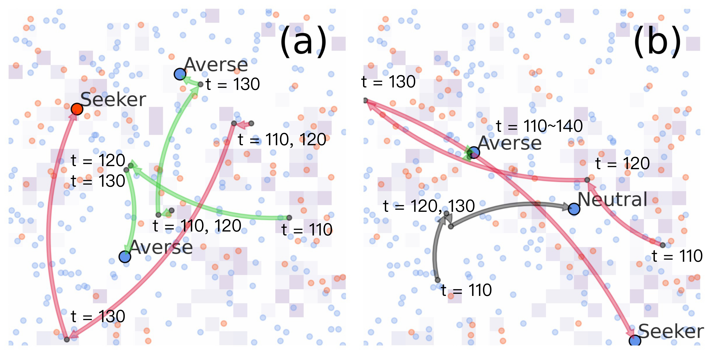
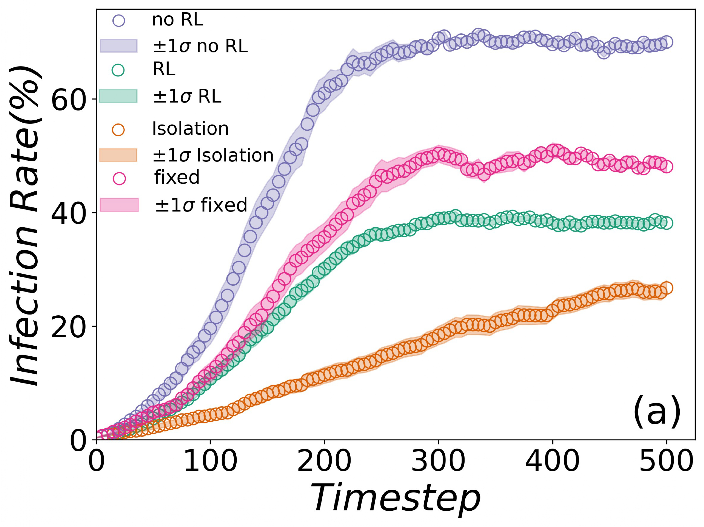
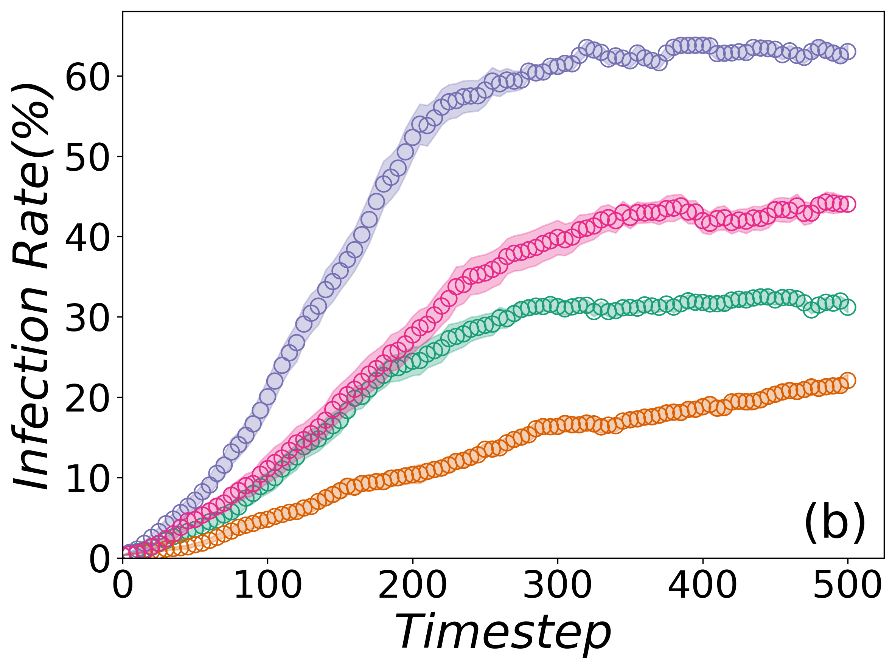
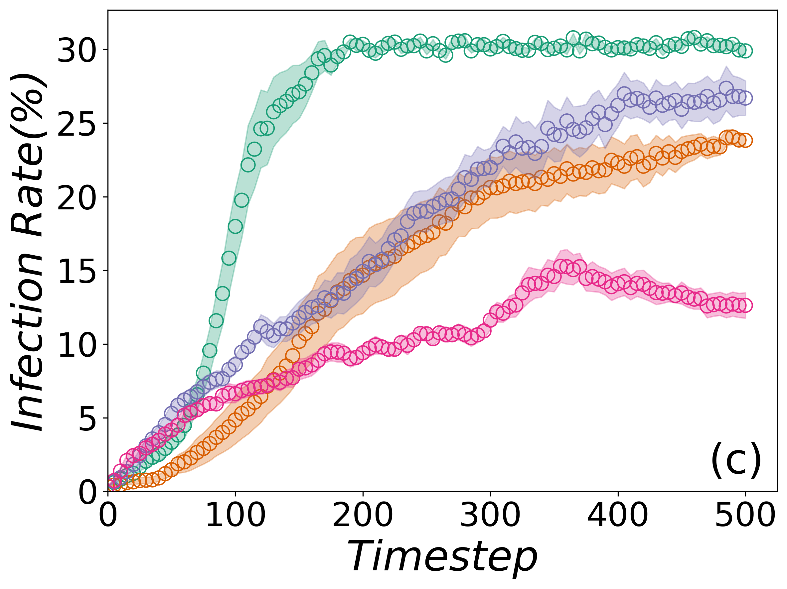
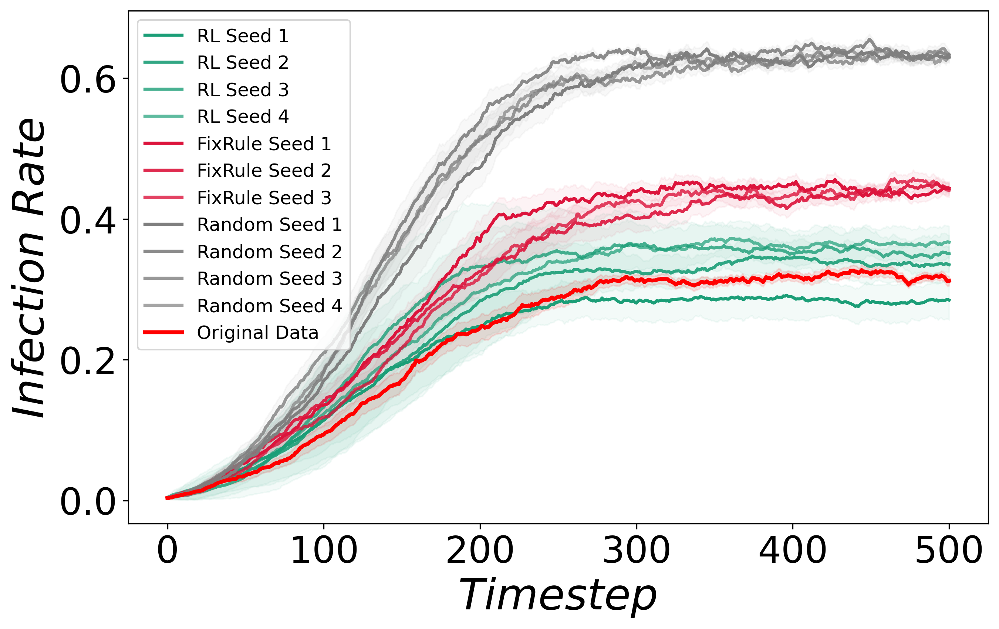
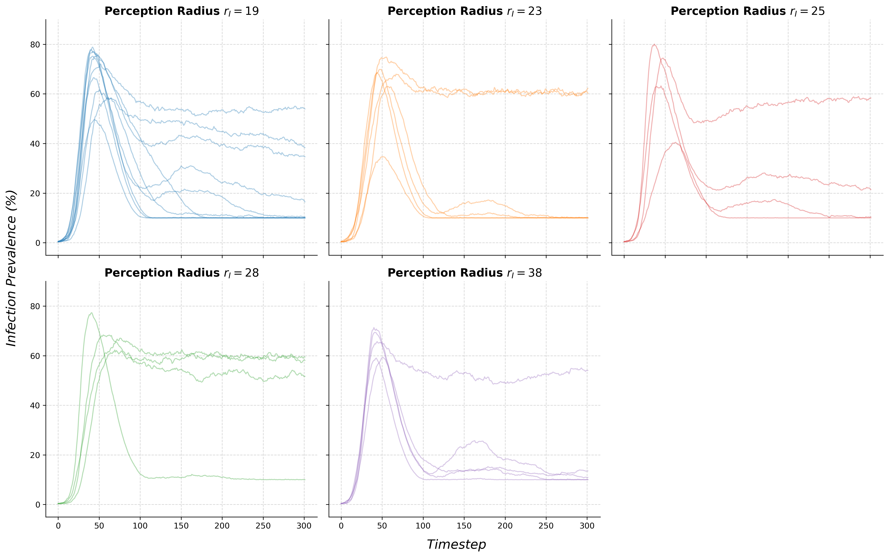

# Replication Scripts & Revision 1 Guide

This subdirectory contains the environment files, Jupyter notebooks, raw seed datasets, and visualization assets required to reproduce the key findings, sensitivity sweeps, and revised trajectory plots from our manuscript.

> **Manuscript History**: First submission on Feb 3rd, 2026. First major revision on May 19, 2026 by *Artificial Intelligence in Medicine*.

---

## 1. Environment Setup

To ensure reproducibility, run your experiments on a GPU instance using the following configuration.

### System Initialization
Launch a RunPod instance with the `grimoire_base` (`runpod/pytorch:2.8.0-py3.11-cuda12.8.1-cudnn-devel-ubuntu22.04`) template. Select a 30 or 40-series GPU and allocate a minimum of **30GB** for both the volume and container disks.

### Virtual Environment & Dependencies
Execute the following commands in the terminal to set up your isolated Python environment and download the core assets:

```bash
cd /workspace
python -m venv gym_env --system-site-packages
source gym_env/bin/activate
```

```bash
pip install "numpy<2" agileRL==2.0.6 openpyxl
pip install torchaudio==2.5.1 torchvision==0.20.1 --no-deps
apt update && apt install -y unzip && pip install gdown
gdown GOOGLE_DRIVE_SHARE_LINK && unzip custom-environment.zip
mkdir -p ./models/MADDPG && gdown GOOGLE_DRIVE_SHARE_LINK -O ./models/MADDPG/MODEL_NAME.pt
```

### Jupyter Kernel Registration
Register the virtual environment as a usable kernel for Jupyter Notebook:

```bash
/workspace/gym_env/bin/python -m ipykernel install --user --name gym_env --display-name "Python (gym_env)"
```

> **Important**: Ensure you switch your kernel to **"Python (gym_env)"** in your Jupyter Notebook interface. We highly recommend using the classic Jupyter Notebook interface instead of Jupyter Lab for optimized performances.

---

## 2. Replication Packages (Zip Files)

Each zip package in this folder contains modified versions of `env{...}.py`, `Inference_{...}.py`, and sometimes `Train_{...}.ipynb` if seed experiments are involved. To run a specific experiment, unzip the package and use its contents to replace/overwrite the default files located in `custom-environment/` or `custom-environment/env/`.

### `Fig 2 Backup.zip`
* **Contents**: The fixed-rule social distancing heuristic with no additional training required is included. Experiment data and the updated environment code is available.
* **Execution**: To reproduce the curves for different recovery rates, open the environment code and manually adjust the recovery rate variable to match the specific panel ($\gamma$ = 5% or $\gamma$ = 10%) you wish to view.

### `Fig 4 Backup.zip`
* **Contents**:  visualization scripts.
* **Execution**: Get the raw trajectory data ready beforehand. Run the visualization script. Specify the following agent sets to reproduce the respective trajectory panels:
  * **Panel A (Early Phase Outbreak)**: Select `['agent_285', 'agent_66', 'agent_76']`.
  * **Panel B (Settling/Localized Outbreak)**: Select `['agent_10', 'agent_11', 'agent_198']`.

### `Fig 6 Backup.zip` & `Fig 7 Backup.zip`
* **Contents**: Updates to the core environment and inference codes modified to collect stepwise reward records. Data and visualization code is provided as well.
* **Execution**: Follow the previous notes.

### `Seed Reproduction.zip`
* **Contents**: Code, raw training curves, and evaluation configurations to reproduce Figure 2's major results.
* **Execution**: Runs the RL policy against both the random (No Policy) and the Fixed-Rule heuristic baselines.

### `Radius Sweep.zip`
* **Contents**: The raw, unselected random seed training code and data used to test perception radius limits.
* **Execution**: Evaluates policies across all converged seeds to reproduce the boundary limits of localized spatial perception.

---

## 3. Key Findings & Behavioral Analysis

### Behavioral Trajectory Mapping (Figure 4)
During infection peak timesteps, agents display high variance and divergence in their movement patterns. 



The spatial trajectories highlight an **early phase of behavioral adaptation**, where agents temporarily elevate their mobility to escape risky zones until a safe place is identified with their observation space. This explains why risk-averse agents briefly traverse higher-risk areas before settling down into low-density pockets, and why there is discrepency among risk types during outbreak.

---

### Baseline Comparison: Fixed-Rule Social Distancing Heuristic
We evaluate our MARL approach against a standard baseline. 

| Panel A | Panel B | Panel C |
| :---: | :---: | :---: |
|  |  |  |

At each step, agent $i$ scans its surrounding space for the number of infected agents within the infection radius $r$. If this count exceeds a risk-type specific threshold, the agent increments its carefulness by $\delta_c$ (bounded by 1.0) and decrements its mobility by $\delta_m$ (bounded by 0.0), both of which decay back toward baseline values $care_i(0)$ and $mov_i(0)$ using the same step sizes once the local infection count falls below the threshold.

> For a complete mathematical formulation and parameter limits of the fixed-rule heuristics, please refer to our published paper: **Artificial Intelligence In Medicine (Submitted June 19, 2026, post first major revision)**.

---

### Convergence Stability under Training Variance
Training Multi-Agent Reinforcement Learning (MARL) algorithms in continuous, stochastic spatial environments is notoriously unstable. To prove policy robustness, we present the results of our models trained across multiple unselected seeds.



No seed was selected, tuned, or excluded. Every trained run is shown (Figure 9). Each curve is the mean over independent evaluation rollouts (30 for the RL policy, 15 for the Fixed-Rule and No-Policy baselines), with shaded bands denoting one standard deviation. The consistent ordering (RL < Fixed-Rule < No-Policy) across all runs confirms that our policy's performance is structurally robust rather than a statistical outlier.

---

### Information Radius Sensitivity (Radius Sweep)
We analyzed how the localized perception radius $\rho_I$ affects policy convergence and adaptation speed.



We report this as a qualitative robustness observation and do not claim a strictly monotonic relationship between radius and adaptation timestep, given the training variance intrinsic to our representative-agent scheme.

---

## Seed Checkpoints
The complete model weights (`.pt` checkpoints) for the trained seeds are large and are therefore omitted from this repository. They are gladly provided upon academic request. 

* **Contact**: [b07801013@ntu.edu.tw](mailto:b07801013@ntu.edu.tw)